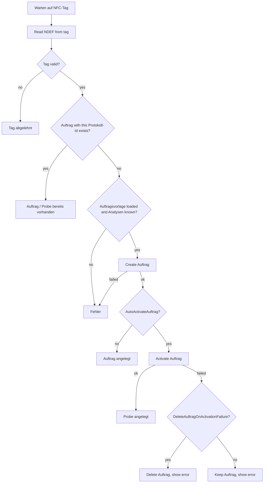

# ArianaNfcClient

Windows desktop app (WPF, .NET 10) that reads NFC tags and creates orders in ArianaLab.

A sample collector writes a water sample protocol to an NFC tag (format `berns-wasser`, version 11). When the tag is placed on the reader, this app validates it, creates an **Auftrag** in ArianaLab from the tag's **Auftragsvorlage** and, by default, activates it so ArianaLab creates the **Probe**.

German terms (Auftrag, Auftragsvorlage, Probe, Gesundheitsamt) are kept as they appear in ArianaLab and in the app.

## Contents

- [How a scan works](#how-a-scan-works)
- [Requirements](#requirements)
- [Configuration](#configuration)
- [NFC tag format](#nfc-tag-format)
- [Mapping to ArianaLab](#mapping-to-arianalab)
- [Build, run and test](#build-run-and-test)
- [Publishing](#publishing)
- [Logging and troubleshooting](#logging-and-troubleshooting)
- [Project structure](#project-structure)

## How a scan works



Every result ends with the same request to the user: remove the tag. The app then returns to waiting.

| Status shown | Meaning |
| --- | --- |
| `Warten auf NFC-Tag…` | Reader is ready. |
| `Tag wird gelesen…` | A tag was detected and is being read. |
| `Probe angelegt – bitte Tag entfernen` | Auftrag created and activated. |
| `Auftrag aktiviert – bitte Tag entfernen` | Auftrag was activated. |
| `Auftrag angelegt – bitte Tag entfernen` | Auftrag created, activation is switched off. |
| `Probe bereits vorhanden` / `Auftrag bereits vorhanden – bitte Tag entfernen` | An Auftrag with this Protokoll-Id already exists. Nothing was created. |
| `Tag abgelehnt – bitte entfernen` | The tag content is invalid. The reason is shown in the result text. |
| `Fehler – bitte Tag entfernen` | Reading, creating or activating failed. Details are shown and logged. |
| `Kein NFC-Leser` | The reader is not connected. |

A tag is processed once. Leaving it on the reader does not create a second Auftrag. It is read again only after it has been removed.

Duplicates are detected through the Protokoll-Id of the tag, which is stored on the Auftrag in the attribute `$Protokoll-Id`.

## Requirements

- Windows 10 or 11, x64.
- [.NET 10 Desktop Runtime](https://dotnet.microsoft.com/download/dotnet/10.0). The ClickOnce installer offers to install it.
- An ACS **ACR1552** NFC reader with its PC/SC driver. The app uses a reader whose name contains `ACR1552` and `PICC`. Otherwise it falls back to any reader whose name contains `PICC`, `Contactless` or `CL `.
- NFC Forum Type 2 (NTAG) or Type 4 tags that carry one NDEF record of type MIME `application/json` or a Text record with the JSON.
- An ArianaLab account that is allowed to create Aufträge in Probenanlage.

## Configuration

Settings come from two places. **The local settings win.**

1. [`appsettings.json`](ArianaNfcClient/appsettings.json) next to the executable, section `ArianaLab`. These are the defaults for every user of the installation.
2. The **settings window** (gear icon in the main window). It saves to `%LOCALAPPDATA%\ArianaNfcClient\connection.json`. The password is encrypted with Windows DPAPI for the current Windows user and cannot be read by other users or on another machine. As soon as this file exists, its address, user, password, both activation switches and the Gesundheitsämter list replace the values from `appsettings.json`.

On a fresh installation `BaseUrl` in `appsettings.json` is empty. Enter the ArianaLab address, user and password in the settings window on first start.

| Option | Default | Purpose |
| --- | --- | --- |
| `BaseUrl` | empty in `appsettings.json` | Address of ArianaLab, for example `https://arianalab.example.de`. Use `https`. |
| `Username` | empty | ArianaLab user. Sent with HTTP Basic authentication. |
| `Password` | empty | Password of that user. |
| `AutoActivateAuftrag` | `true` | Activate the Auftrag right after it was created, so the Probe is created. When `false` the Auftrag stays unactivated. |
| `DeleteAuftragOnActivationFailure` | `false` | Delete the Auftrag again if activation fails, so no half-finished order remains. |
| `HealthAuthorities` | empty | List of Gesundheitsämter used to fill the attribute `Kopie` (see below). |
| `CreatePath` | `/Rest/Opd/Probenanlage/Auftraege` | REST path for Aufträge. Normally not changed. |
| `ProtocolAttributeName` | `$Protokoll-Id` | Attribute that stores the Protokoll-Id. |

### Gesundheitsämter list

In the settings window, **Datei laden…** reads a text file with one Gesundheitsamt per line (UTF-8 or Windows-1252, duplicates and empty lines are ignored).

If the tag says `Weitergabe` = `Ja` and a line contains the tag's `Kurzname`, that line is written to the attribute `Kopie` of the Auftrag.

### Redirects

The app does not follow redirects blindly, because the credentials are sent with every request. A redirect is followed only when it goes to the **same host**, changes the scheme from **http to https** and points to the root path `/`. The new address is then used for all further requests. Every other redirect is not followed and is reported as an error. Configure `BaseUrl` with `https` to avoid redirects altogether.

## NFC tag format

The tag holds a JSON document. The structure is checked against [`ReferenceScheme.json`](ArianaNfcClient/Models/ReferenceScheme.json) plus a few additional rules.

Shortened example:

```json
{
  "Format": "berns-wasser",
  "Version": 11,
  "Protokoll": { "Id": "01a1f811-643d-7965-8587-49ab45ba5918", "Erstellt": "2026-11-20T09:27:42+01:00" },
  "Probenehmer": { "Bezeichnung": "Herr Dr. J. Dietrich (Dr. Berns Laboratorium)" },
  "Kunde": { "Nummer": "30001", "Name": "Testkunde - Standort" },
  "Gesundheitsamt": { "Kurzname": "Kleve", "TeisKreisNummer": "05154", "Weitergabe": "Ja" },
  "Auftragsvorlage": { "Name": "Vorlage A" },
  "Entnahme": {
    "Zeitpunkt": "2026-11-20T09:27:00+01:00",
    "Objekt": "Haus",
    "Nachprobe": "Nein",
    "Wassertyp": "Kaltwasser",
    "Stelle": "Badezimmer"
  },
  "Analysen": [ "Blei", "Cadmium" ],
  "Bericht": { "ProbenahmegebuehrUeberLabor": false }
}
```

Rules:

- `Format` must be `berns-wasser` and `Version` must be `11`.
- Required objects and fields: `Protokoll` (`Id`, `Erstellt`), `Kunde` (`Name`), `Gesundheitsamt` (`Weitergabe`), `Auftragsvorlage` (`Name`), `Entnahme` (`Wassertyp`, `Stelle`) and `Bericht` (`ProbenahmegebuehrUeberLabor`).
- `Entnahme.Wassertyp` is `Kaltwasser`, `Heisswasser` or `Mischwasser`.
- `Gesundheitsamt.Weitergabe` is `Ja`, `Nein` or `WennOkJa`. Unless it is `Nein`, `Kurzname` is required.
- `Analysen`, when present, must contain at least one entry.
- Text may contain JSON escapes such as `\u00fc`, including surrogate pairs for characters outside the basic plane.

### Analysen

The Auftragsvorlage in ArianaLab decides which analyses an Auftrag contains. The tag can narrow that down:

- No `Analysen` on the tag: the **complete** Auftragsvorlage is used.
- `Analysen` on the tag: only these analyses are kept. Names must match the analyses in the Auftragsvorlage exactly, ignoring case and surrounding spaces. Positions that end up without analyses are removed.
- If the tag names an analysis that the Auftragsvorlage does not contain, the Auftrag is **rejected** with the error `Analysen nicht in der Auftragsvorlage enthalten: …`. Nothing is created in ArianaLab.

If the Auftragsvorlage itself cannot be loaded (ArianaLab not reachable, login failed, name unknown), nothing is created either.

### Times

`Entnahme.Zeitpunkt` and `Protokoll.Erstellt` may be written with an offset (`+01:00`, `Z`) or without. A time without offset is read as local time of the PC. The times are sent to ArianaLab as UTC and shown there in local time, so the day does not shift.

## Mapping to ArianaLab

The app starts from the effective Auftragsvorlage in ArianaLab and overwrites the following. The details are in [`BernsWasserAuftragMapper.cs`](ArianaNfcClient/Services/ArianaLab/BernsWasserAuftragMapper.cs).

| Tag | Auftrag |
| --- | --- |
| `Kunde` | Kunde (number and name) |
| `Auftragsvorlage.Name` | Auftragsvorlage |
| `Probenehmer.Bezeichnung` | Probenehmer |
| `Entnahme.Objekt`, `Stelle`, `Wassertyp` | Probenbezeichnung of the Auftrag: `Objekt, Stelle, PWC/PWH/MW` |
| `Entnahme.Zeitpunkt` | Probenahmedatum and the attribute `Probenahme (Zeit)` (HH:mm, local time) |
| `Protokoll.Erstellt` | Probeneingang |
| `Beschaffenheit.Temperatur` | Eingangstemperatur |
| `Protokoll.Id` | Attribute `$Protokoll-Id` (duplicate detection) |
| `Gesundheitsamt` | Attributes `Weitergabe`, `TeisKreisNummer` and, with the Gesundheitsämter list, `Kopie` |
| `Entnahme.Nachprobe` = `Ja` | Attribute `Bemerkung` = `Nachprobe` |
| `Entnahme.Aufbereitung`, `ArtDesWassers`, `ZidNr`; `Flaschen`; `Bericht`; `Bemerkung`; `ExtraTexte` | Further attributes of the Auftrag |
| `Analysen` | Filter on the analyses of the Auftragsvorlage (see above) |

Attributes that are only for internal use (for example `Weitergabe`, `TeisKreisNummer`, number of bottles, `Prüfbericht an`, `Kostenträger`) are created with a leading `.`. ArianaLab removes the dot when the Auftrag is activated, and until then they stay off the Prüfbericht.

## Build, run and test

```powershell
dotnet build ArianaNfcClient.slnx
dotnet run --project ArianaNfcClient
dotnet test ArianaNfcClient.slnx
```

The solution has two projects: the app and `ArianaNfcClient.Tests`.

The tests use [xUnit v3](https://xunit.net) and need neither a reader nor an ArianaLab server. HTTP calls, the ArianaLab client and the settings store are replaced by fakes in `ArianaNfcClient.Tests/Support`. They cover:

- the mapper (Analysen filter, times, Kopie, Nachprobe, template cleanup)
- the tag validator and the JSON unicode escapes
- `ArianaLabClient` (create, activate, Auftragsvorlage failures, redirect rule)
- the activation flow in `MainViewModel` (automatic activation on and off, existing Auftrag, delete on failure)
- `NdefDecoder` (complete, truncated and incomplete tags)

## Publishing

The app is distributed with ClickOnce. The profile is
[`ClickOnceProfile.pubxml`](ArianaNfcClient/Properties/PublishProfiles/ClickOnceProfile.pubxml): framework-dependent, installs from disk, creates a desktop shortcut, includes the .NET Desktop Runtime 10 prerequisite and has automatic updates.

```powershell
dotnet publish ArianaNfcClient -p:PublishProfile=ClickOnceProfile
```

The result is in `ArianaNfcClient\bin\Release\net10.0-windows\app.publish\`. In Visual Studio use **Publish** with the same profile. Increase `Version` in [`ArianaNfcClient.csproj`](ArianaNfcClient/ArianaNfcClient.csproj) and the profile for a new release.

## Logging and troubleshooting

Logs are written by NLog to `logs\ariana-nfc.log` in the application folder. They roll over daily and are kept for 30 days ([`nlog.config`](ArianaNfcClient/nlog.config)). The **Logs** button in the settings window opens the folder.

| Message | Cause and remedy |
| --- | --- |
| `Kein NFC-Leser` | The reader is unplugged or the PC/SC driver is missing. Connect it. The app picks it up again automatically. |
| `Tag wird gelesen…` followed by an error about a truncated read | The tag was moved while it was read. Remove it and hold it still on the reader. |
| `Tag abgelehnt – bitte entfernen` | The tag content is wrong. The result text names the field. See [NFC tag format](#nfc-tag-format). |
| `ArianaLab-Zugangsdaten fehlen.` | Address, user or password is empty. Enter them in the settings window. |
| `Anmeldung bei ArianaLab fehlgeschlagen.` | User or password is wrong, or `BaseUrl` points to a different page. |
| `Auftragsvorlage '…' ist in ArianaLab nicht vorhanden.` | The Auftragsvorlage named on the tag does not exist in this ArianaLab. Check the name. |
| `Analysen nicht in der Auftragsvorlage enthalten: …` | The tag asks for analyses that the Auftragsvorlage does not contain. Fix the tag or the Auftragsvorlage. |
| `ArianaLab ist nicht erreichbar.` | Network or server problem. Check `BaseUrl` and the connection. |
| Log entry `Ignoring redirect from … to …` | The server redirected somewhere the app does not follow. Set `BaseUrl` to the final `https` address. |

When an activation fails, the window shows the reason and a link to the Auftrag in ArianaLab. With `DeleteAuftragOnActivationFailure` the Auftrag is deleted again.

## Project structure

```text
ArianaNfcClient.slnx
ArianaNfcClient/                    WPF application
  Models/                           Options, tag payload, events, JSON scheme of the tag
  Services/
    ArianaLab/                      ArianaLabClient (REST) and BernsWasserAuftragMapper
    Nfc/                            Acr1552NfcReaderService (PC/SC) and NdefDecoder
    Validation/                     TagPayloadValidator, JSON unicode escapes
    Connection/                     Local settings store (DPAPI protected password)
    NfcWatchHostedService.cs        Background loop that forwards reader events
  ViewModels/                       MainViewModel (status and activation flow)
  Views/                            Main, settings and activation-failed windows
ArianaNfcClient.Tests/              Unit tests (xUnit v3) and fakes
```
